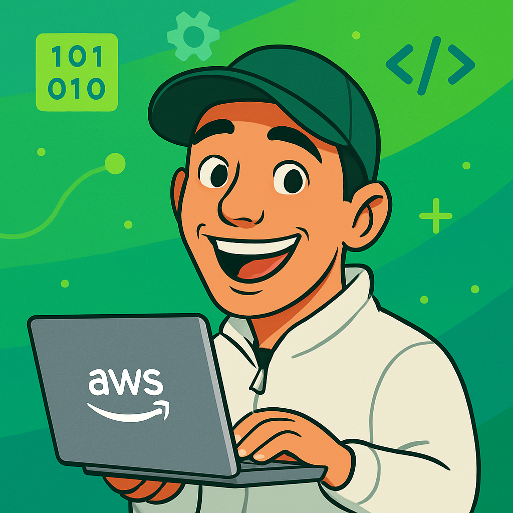

  

<h1 align="center">Hola, soy Yeisson Otalora 👋</h1>

<h3 align="center">Profesional en Ingeniería de Software · Full Stack TypeScript Developer</h3>

  Construyo aplicaciones web, APIs e integraciones con TypeScript. Me interesa entender cómo funciona el negocio
  y convertir sus necesidades en soluciones útiles, mantenibles y listas para producción.

  
  
  

---

### Sobre mí

Me gusta construir productos web que resuelvan problemas reales: entender cómo funciona el negocio, traducir sus necesidades en soluciones claras y llevarlas hasta producción.

Trabajo principalmente con **TypeScript**, tanto en backend con **Node.js** como en frontend con **React, Next.js y Vue**. También disfruto conectar sistemas, diseñar APIs y mejorar aplicaciones que ya están en funcionamiento.

Empecé en 2017 con COBOL y migraciones de sistemas legacy. Hoy construyo plataformas web, APIs e integraciones que corren en producción.

---

### Stack

Hoy trabajo con **TypeScript, Node.js, React, Next.js y PostgreSQL**, y antes con Vue. Esto es lo demás que he usado en proyectos reales:

| Área | Tecnologías |
|------|-------------|
| **Backend** | Node.js · TypeScript · Express · Prisma · APIs REST · Microservicios · Socket.IO · JWT |
| **Frontend** | React · Next.js · Vue · Nuxt · Tailwind CSS · Redux · Vuex · Formik · Yup · React Hook Form · Zod |
| **Móvil** | Capacitor · Framework7 |
| **Bases de datos** | PostgreSQL · SQL · MongoDB · Supabase |
| **Cloud e infraestructura** *(experiencia práctica)* | AWS S3 · SES · SQS · Connect · Textract · ECS/ECR · Lambda · Docker · Vercel · CI/CD |
| **Integraciones y calidad** | ePayco · Hikvision · Webhooks · Jest · Sentry · CodeRabbit · Postman · Swagger |
| **Herramientas** | Git · Claude Code · Cursor · VS Code · NPM |
| **También** | COBOL · Java · Python |

  

---

### Experiencia

#### Multisalud — Desarrollador web Full Stack (Freelance) · Abr 2024 – actualidad
Plataforma web multiempresa del sector salud, con subdominios y datos segmentados por empresa. Desarrollo interfaces, lógica de negocio y servicios backend.
- Agendamiento de citas, digiturno, historias clínicas, superadministración, control de permisos y un diseñador de formularios dinámicos.
- Integraciones con servicios externos: pagos con ePayco, torniquetes Hikvision y webhooks.
- Notificaciones por WhatsApp, llamadas telefónicas (AWS Connect), SMS y correo electrónico.
- Optimización de consultas SQL, pruebas unitarias con Jest y revisión de código con Claude Code y CodeRabbit.
- Despliegues en QA y producción, y acompañamiento técnico al equipo.

TypeScript, Node.js, React, Next.js, Redux, React Hook Form, Zod, PostgreSQL, Prisma, Socket.IO, JWT, Jest, Sentry, Docker, AWS (S3, SES, SQS, Connect, Lambda, ECS/ECR)

#### Titan Soluciones S.A.S. — Proyectos freelance · Desarrollador Full Stack · Jun 2021 – Mar 2024
- Apps móviles híbridas (Vue, Framework7, Capacitor) para el registro de tiquetes de transporte intermunicipal y la gestión de pedidos de comercializadoras.
- Integración de facturación electrónica y nómina electrónica.
- Microservicios con Node.js y Prisma.

Vue, Vuex, Nuxt, Framework7, Capacitor, Node.js, Prisma

#### AYS Siged S.A.S. — Desarrollador web Full Stack · Abr 2022 – Mar 2024
- Mantenimiento y evolución de una plataforma existente con Vue, Node.js y MongoDB.
- Servicio de extracción de texto desde PDF con AWS Textract, Node.js y Java.
- Notificaciones con AWS SES y almacenamiento de archivos con S3.

Vue, Node.js, MongoDB, Java, AWS (Textract, SES, S3)

#### SC Prosoft S.A.S. — Desarrollador de software · Oct 2017 – Mar 2022
- Comencé como desarrollador COBOL y luego asumí proyectos de desarrollo web.
- Migración de módulos legacy a plataformas web y construcción de nuevas plataformas.
- Apoyo en la supervisión de parte de esas migraciones.

---

### Proyectos

| Proyecto | Tipo | Descripción | Tecnologías |
|----------|------|-------------|-------------|
| [**VOKOX**](https://vokox.app) | Tienda online · marca de streetwear | Proyecto web para una marca de streetwear: catálogo de productos y presencia digital de la marca. | React, TypeScript, Tailwind CSS, Supabase, Vercel |
| [**Movilcell**](https://www.movilcell.shop) | Desarrollo web para cliente | Una tienda de celulares necesitaba mostrar su catálogo en línea y facilitar la venta a crédito: el sitio presenta sus productos y lleva al cliente a solicitar el crédito o escribir por WhatsApp. | React, TypeScript, Tailwind CSS, Supabase, Vercel |

---

### Formación

- **Ingeniería de Software** — Politécnico Grancolombiano, 2026
- **Diplomado Full Stack** — Inandina, 2019
- **Tecnólogo en Análisis y Desarrollo de Sistemas de Información** — SENA, 2017

**Idiomas:** español nativo · inglés A2

---

### ¿Hablamos?

Estoy abierto a oportunidades laborales y proyectos freelance.
Escríbeme a **yeison9713@gmail.com**, conéctate en [LinkedIn](https://www.linkedin.com/in/jsonotalora/) o mira mi [portafolio](https://yeison9713.github.io/full-stack-json/).
